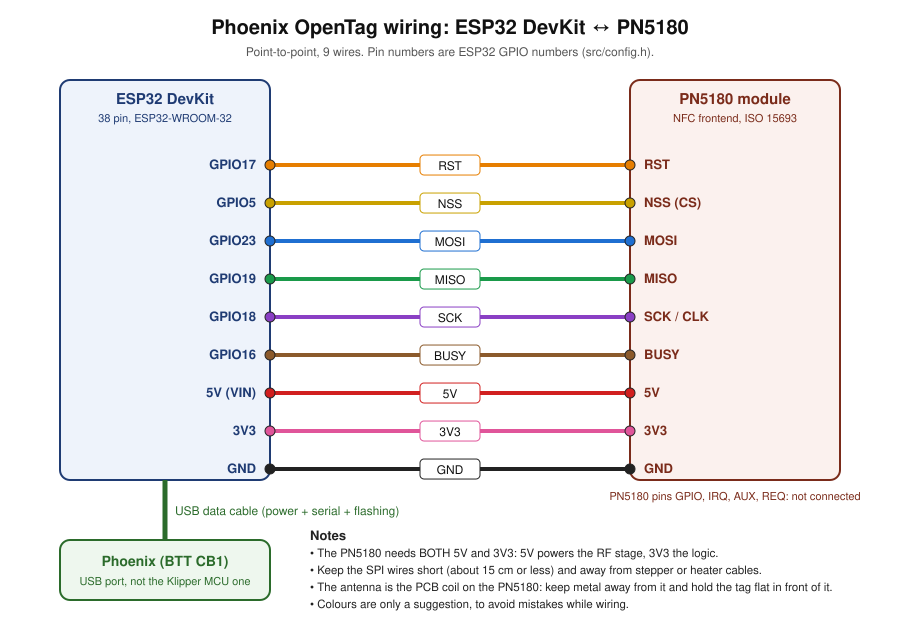

# Phoenix OpenTag

> [!CAUTION]
> **Experimental hobby project: use it entirely at your own risk.** It comes with no warranty, and the author is **not responsible** for any damage to printers, PCs, hardware, software or data. Read the Disclaimer section of this README before you build, flash or run anything.
>
> *Progetto sperimentale: uso a proprio rischio e pericolo. L'autore non risponde di alcun danno a stampanti, computer, hardware, software o dati.*

A minimal NFC reader and writer for **OpenPrintTag** tags (the Prusa Research standard), based on an **ESP32 + PN5180** and designed to be connected to the Sovol SV08 "Phoenix".

Born as a reduced version of [Odin-ESP32](https://github.com/Ricky1966/Odin-ESP32) (a filament drying station): the hardware initialization comes from Odin's `develop` branch, with a separate parser and checks on NFC reads, but without the web dashboard, heater, environment sensors or multi-spool handling. It validates the reads and integrates with Spoolman and Moonraker.

## ⚠️ Disclaimer: use at your own risk

Phoenix OpenTag is an experimental hobby project, provided **"as is"**, without warranty of any kind. It means flashing firmware, wiring electronics, writing to NFC tags, sending commands to a printer's firmware (Klipper/Moonraker) and installing software on your computers. Mistakes, bugs or incompatibilities can cause failed prints, damage to your printer(s), your computer(s), the ESP32/PN5180 module, the tags or any other hardware or software, loss of data, or other harm.

By building, installing, running or modifying anything here you accept that you do so **entirely at your own risk**. The author and the contributors are **not responsible or liable** for any damage or loss of any kind: printers, PCs, hardware, software, data or anything else. Test carefully, never leave a printer unattended, back up your configuration before changing it, and read the code before you run it. The warranty disclaimer of the AGPL-3.0 licence (sections 15 and 16) applies as well.

*In italiano: progetto sperimentale da usare **a proprio rischio e pericolo**. L'autore non risponde di alcun danno a stampanti, computer, hardware, software o dati.*

---

## What it does

- Connects to the home WiFi (station mode, no Access Point), used for sending in `wifi`/`auto` mode and for OTA updates.
- Continuously reads the ISO15693/NFC-V tags near the PN5180 (the protocol used by OpenPrintTag).
- When it recognizes an OpenPrintTag, it prints on the serial port: brand, material, colour, diameter, density, nozzle/bed temperature range, weight, country.
- Prints the data when the tag changes or a valid read is recovered. It only sends validated data.
- Sends every new read to the daemon on Phoenix, over **USB** or **WiFi** as you choose (see below). The daemon passes it to Spoolman and sets the active spool in Moonraker.
- **Writes** OpenPrintTag images to blank or existing ICODE SLIX2 tags, driven by the Spoolman fork's «Scrivi tag» button, and offers to write a blank tag when one is placed on the reader (see below).

## Writing tags

The firmware writes complete OpenPrintTag images to **ICODE SLIX2 tags with 316 user bytes**, with UID check, protection checks, explicit consent to replace existing data and a full read-back. Serial protocol, command-line client and limits: [procedure and limits](docs/tag-writing.md).

With the [Spoolman fork](https://github.com/Ricky1966/Spoolman) the whole flow runs from the web UI: open a saved spool, press **Scrivi tag**, check the pre-filled data, place the tag and confirm. The tag is linked to the spool only after the firmware has verified it. Validated on real hardware on 1 October 2026. Setup of the authenticated bridge between Spoolman and the daemon is described in [docs/tag-writing.md](docs/tag-writing.md).

A **blank** SLIX2 tag placed on the reader while the printer is idle is reported to Spoolman, which proposes the spool without a tag and asks for confirmation before writing; after a verified write the tag is read again and the spool becomes active. The reader stays disarmed while a print is running or paused, or while Klipper is running G-code (macros, filament loading).

## Hardware

- ESP32 DevKit, 38 pin (AZ-Delivery ESP32-WROOM-32)
- PN5180 module (NXP/AZ-Delivery breakout)
- ICODE SLIX2 tags, jumper wires and a USB data cable

The full **bill of materials**, tag requirements and the **wiring schematic** are in [docs/hardware.md](docs/hardware.md).



Point-to-point wiring:

| PN5180 signal | ESP32 GPIO |
|---|---|
| RST | 17 |
| NSS (CS) | 5 |
| MOSI | 23 |
| MISO | 19 |
| SCK / CLK | 18 |
| BUSY | 16 |
| 5V | 5V |
| 3V3 | 3V3 |
| GND | GND |

## Setup

```bash
cp src/secrets.h.example src/secrets.h
# edit src/secrets.h with the real WiFi SSID/password
pio run --target upload
pio device monitor
```

`src/secrets.h` is not versioned (see `.gitignore`).

## Updating over WiFi (OTA)

Since 0.4.0 the firmware can also be updated over WiFi, without unplugging the ESP32 from Phoenix. WiFi always stays on, even in `usb` mode, because OTA needs it.

1. In `src/secrets.h` add the OTA password (see `secrets.h.example`); without this line OTA stays disabled:
   ```c
   #define OTA_PASSWORD "choose-a-password"
   ```
2. **Once, over USB**, flash the first firmware that has OTA: `pio run -t upload --upload-port <port>`. At start-up you must see `OTA attivo: phoenix-opentag.local (<IP>)`.
3. From then on, from the PC:
   ```bash
   PHOENIX_OTA_PASSWORD='choose-a-password' pio run -e esp32dev_ota -t upload
   ```
   If `phoenix-opentag.local` does not resolve, add `--upload-port <ESP32 IP>` (printed by `show`).

Use only letters and digits for `OTA_PASSWORD`: PlatformIO inserts it into the command without quotes, so `&`, `;`, `$` or spaces break it. `espota.py --debug` prints the password in clear text: do not use it. The password is compiled into the firmware, so changing it requires a new flash over USB.

During the update NFC reading is paused; when it finishes the ESP32 restarts and the daemon on Phoenix resumes reading the serial port by itself.

## Sending to Phoenix: USB or WiFi

The mode is chosen from the serial port (`pio device monitor`, 115200) and is kept in flash, with no recompilation:

| Command | Effect |
|---|---|
| `show` | current settings |
| `mode usb` | every read goes out on the serial port as a `PHOENIX-TAG {json}` line, read by the daemon (default) |
| `mode wifi` | HTTP `POST <host>/tag` with the same JSON |
| `mode auto` | WiFi if connected and the POST succeeds, otherwise USB |
| `host http://<phoenix-ip>:7913` | address of the daemon on Phoenix |
| `reader <id>` | `reader_id` shown in Spoolman (default `phoenix-opentag`) |
| `test` | resend the last tag read |
| `reboot` | restart, required after `mode` |

The initial values are in `src/config.h` (`TRANSPORT_DEFAULT_*`). JSON v1 sent since version 0.5 (fields missing from the tag are omitted; the daemon also accepts the 0.4 names):

```json
{"schema_version":1,"event_id":"12ab34cd-00000001","uid":"E004010812345678","reader_id":"phoenix-opentag","firmware":"0.5.0-dev","brand_name":"Prusament","material_name":"PLA Galaxy Black","color_rgba":"#3D3E3DFF","filament_diameter":1.75,"density":1.24,"nominal_netto_full_weight":1000}
```

The firmware keeps only the latest valid read: it retries after 5, 10, 20, 40 and 60 seconds (maximum), pauses sending on an NFC error and cancels the event when the removal is confirmed. Over USB the daemon replies `ack <event_id>` only after successful handling; over WiFi a Moonraker error produces HTTP 502. The two transports share the same event in `auto` mode. POSTs are synchronous and can temporarily delay NFC polling and OTA. The full contract is in [docs/http-contract.md](docs/http-contract.md).

An activation refused during `printing`/`paused` is a final outcome: it is not queued for the end of the print. After the print you need a new read, or `test`. The weights of spools that are already registered are not updated from the tag.

**Upgrading from 0.4:** install the new daemon first (it is compatible with both formats), then the firmware. Restart only `phoenix-opentag` after updating the files. Verify with a known spool, with the printer idle. Keep `src/secrets.h`, the NVS settings and the `--serial` parameters of the existing service.

## Daemon on Phoenix

`host/phoenix_opentag_daemon.py` runs on the CB1 with the system `python3` (no dependencies). For every read:

1. it calls `POST /api/v1/tag/scan` on Spoolman (≥ 0.27.0), which resolves the UID to the linked spool;
2. if the UID is unknown and the tag carries at least `material` and `density`, it creates the spool, reusing the vendor (`brand`) and filament (name, vendor, colour, diameter) if they already exist, and links the tag to it;
3. it sets the active spool with `POST /server/spoolman/spool_id` on Moonraker, **but not if the printer is `printing` or `paused`**.

Only consecutive identical events handled successfully within 5 s are deduplicated; A → B → A reactivates A. Temporary errors are not remembered as successes. Useful options: `--no-create`, `--no-activate`, `-v`.

```bash
# manual test on Phoenix
python3 ~/phoenix-opentag/host/phoenix_opentag_daemon.py --listen 0.0.0.0:7913 \
    --serial /dev/serial/by-id/usb-1a86_USB_Serial-if00-port0   # only for usb/auto
curl -s http://localhost:7913/health

# permanent service
sudo cp ~/phoenix-opentag/host/phoenix-opentag.service /etc/systemd/system/
sudo systemctl daemon-reload && sudo systemctl enable --now phoenix-opentag
journalctl -u phoenix-opentag -f
```

To switch the service to USB mode, add `--serial` to the `--listen` line and restart it:

```bash
sudo sed -i 's|--listen 0.0.0.0:7913 \\|--listen 0.0.0.0:7913 --serial /dev/serial/by-id/usb-1a86_USB_Serial-if00-port0 \\|' /etc/systemd/system/phoenix-opentag.service
sudo systemctl daemon-reload && sudo systemctl restart phoenix-opentag
```

To send commands to the ESP32 while it is connected to Phoenix, stop the daemon (`sudo systemctl stop phoenix-opentag`: the port must not be read by two programs) and use the serial monitor included with Klipper. Exit with `Ctrl+]`, which on an Italian keyboard is `Ctrl+5`:

```bash
~/klippy-env/bin/python -m serial.tools.miniterm -e /dev/serial/by-id/usb-1a86_USB_Serial-if00-port0 115200
```

With `--serial` always use the `/dev/serial/by-id/...` path of the ESP32. The daemon refuses to open a port that appears as `serial:` in Klipper's `.cfg` files (`--klipper-config`, default `~/printer_data/config`).

The daemon and Spoolman have no authentication: expose them only on the local network. The writer API of the daemon is disabled unless `PHOENIX_WRITER_TOKEN` is set.

## Validation

PC tests: parser, delivery, ISO15693 driver, 40,000 altered inputs, the six official OpenPrintTag tags, the writer (interruptions at every block, locks, an unwritable block 79) and daemon/bridge regressions (see "PC tests").

**1 October 2026, tag writing: PASS on real hardware.** Writing failed at first because ICODE SLIX2 block 79 is a read-only counter, not user memory; after limiting the writer to the 316 user bytes (blocks 0–78) a tag was restored from a backup (`verified: true`, block 79 untouched), then written from the Spoolman web UI: verified by the firmware, linked to the spool, re-read without creating a duplicate, and the spool made active in Moonraker.

**30 September 2026, consolidated version `0.5.0-dev`: PASS on real hardware.** Flash over USB, then a successful **OTA update over WiFi** with the final password. At start-up: WiFi connected, PN5180 3.5 OK, `OTA attivo`. The ODIN test tag is read and sent as a `PHOENIX-TAG` line (JSON v1). The daemon of this branch, installed on Phoenix in place of the previous version, finds spool 2 again in USB mode (`created: false`) and activates it in Moonraker. Locally, with Spoolman 0.27.0, the daemon creates vendor, filament, spool and link from the firmware line, replies `ack <event_id>`, ignores a repeated `event_id` and does not activate the spool while the printer is `printing`.

Still to verify: that the ESP32 really receives the ACK from the daemon, the `wifi` and `auto` modes with the consolidated firmware, the blank-tag proposal on a real blank tag, and the reading of tags not written by Odin.

Earlier tests, on version 0.4 (0.4 daemon):

**29 September 2026, WiFi mode: PASS on real hardware.** ESP32 DevKit (CH340) + PN5180 3.5, OpenPrintTag test tag (UID `E0:04:01:08:66:07:15:E3`, ODIN Test PLA). Phoenix: Spoolman 0.27.0 in Docker, daemon started by hand with `--listen 0.0.0.0:7913`.

- First read: the daemon created vendor ODIN, filament "Test PLA" and spool 2 with the tag linked, then made it active in Moonraker (`GET /server/spoolman/spool_id` → `2`). Time from read to activation: about 1 s.
- Second read, after removing the tag for more than 5 s: spool 2 found again (`created: false`) and reactivated, no duplicate.

- Daemon installed as a service (`host/phoenix-opentag.service`, `enable --now`): the same read reactivates spool 2; a second tag (UID `E0:04:01:08:66:07:19:17`, BravaSoft Test PLA) creates vendor BravaSoft, a separate filament and spool 3, which becomes the active one.

- **USB mode: PASS.** ESP32 connected to a USB port of Phoenix (`/dev/serial/by-id/usb-1a86_USB_Serial-if00-port0`, next to the Klipper MCU `usb-Klipper_stm32f103xe_...`), service started with `--serial` on that path. The read arrives as `[usb]` and reactivates spool 2.

## PC tests

`bash tests/run_host.sh` (only needs `g++`) builds with AddressSanitizer and tests: the parser and the delivery, the ISO15693 driver and the **six official example tags** of the OpenPrintTag specification (`tests/fixtures/official/`, Prusa Research MIT licence in `tests/fixtures/LICENSE.openprinttag`; expected values generated with their reference Python implementation), the writer and its serial protocol, plus truncations and randomly altered bytes with no out-of-bounds access. The sixth tag has a maximum nozzle temperature below the minimum and is a deliberately invalid case: the parser rejects it. If a tag does not state the diameter, the parser assumes 1.75 mm as the specification says. The Python parts (daemon, writer client, bridge) are tested with `python3 -m unittest discover -s tests -p 'test_*.py'`. GitHub CI runs the same checks and builds the firmware.

The 0.4 parser did not read the official tags (it did not handle the meta section, indefinite-length CBOR maps and long NDEF records): it only worked with tags written by Odin.

## Next steps

- Orca Slicer integration: have the slicer take the active spool from Spoolman/Moonraker (for example with spoolman2slicer or a tap-driven active spool). To be decided.
- Test OpenPrintTag tags from different manufacturers.
- Send the tag's raw memory to Spoolman (`payload_b64` of `POST /tag/scan`, which Spoolman currently retransmits without decoding) and decode it there. The specification and the reference implementation are in the `prusa3d/OpenPrintTag` repository (MIT licence).

## Structure

```
src/
  config.h        PN5180 pins, timing, include of secrets.h
  secrets.h       WiFi credentials (not versioned, see secrets.h.example)
  nfc.h/.cpp      PN5180 reading with error handling, blank-tag detection
  nfc_writer.inc  Serial write protocol (write-info/commit/cancel/resume), included by nfc.cpp
  tag_parser.*    Validated NDEF/CBOR parser, testable without hardware
  tag_writer.*    Verified SLIX2 writer (user blocks 0-78), testable without hardware
  delivery.*      JSON v1 and delivery-attempt state
  transport.h/.cpp  Sending reads to Phoenix (USB/WiFi), serial commands, settings in flash
  main.cpp        setup() + loop(), WiFi and OTA
tests/            PC tests (`bash tests/run_host.sh`, `python3 -m unittest`): parser, delivery, ISO15693, official tags in fixtures/official, writer, daemon, bridge
docs/
  hardware.md       Bill of materials, tag requirements, wiring and assembly checks
  wiring.svg        Wiring schematic
  http-contract.md  Reader -> daemon contract (JSON v1, ACK, retries, blank tag)
  tag-writing.md    Writing tags: protocol, backups, bridge to Spoolman
.github/workflows/check.yml  CI: tests, daemon on Python 3.9, build with and without OTA
host/
  phoenix_opentag_daemon.py  Daemon for Phoenix: serial/HTTP -> Spoolman -> Moonraker
  phoenix_opentag_write.py   Command-line writer client with backups
  phoenix_writer_bridge.py   Authenticated bridge used by the Spoolman fork
  phoenix-opentag.service    systemd unit
lib/PN5180-Library/  Vendored PN5180 library (from Odin-ESP32)
```

## References

- [OpenPrintTag](https://openprinttag.org/) — open-source NFC standard by Prusa Research
- [Odin-ESP32](https://github.com/Ricky1966/Odin-ESP32) — source project (filament dryer)
- [Spoolman fork with the «Scrivi tag» button](https://github.com/Ricky1966/Spoolman)

## Licence

Distributed under the GNU Affero General Public License v3.0.

SPDX-License-Identifier: AGPL-3.0-or-later

The repository includes third-party code and data with their own licences (a modified copy of the PN5180 Library, LGPL-2.1-or-later, and OpenPrintTag test data, MIT): see [NOTICE.md](NOTICE.md).
