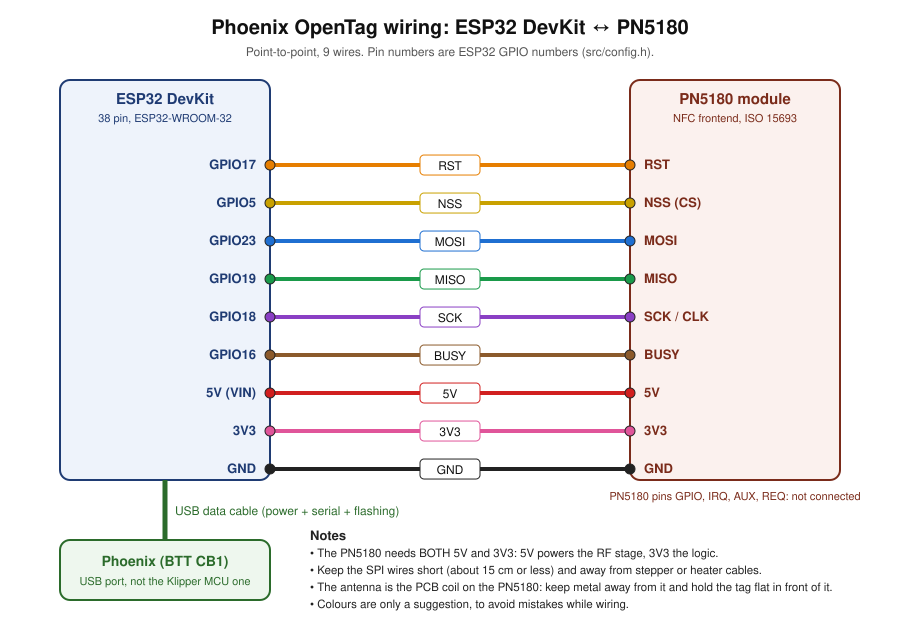

# Hardware: bill of materials and wiring

The reader is an ESP32 DevKit with a PN5180 NFC module, connected to the Phoenix
(BTT CB1) by a USB cable. Nothing else is needed on the printer side: the daemon runs on
the CB1 and talks to Spoolman and Moonraker.

## Bill of materials

| # | Item | Qty | Notes |
|---|---|---|---|
| 1 | ESP32 DevKit, 38 pin (ESP32-WROOM-32) | 1 | Tested with the AZ-Delivery ESP32 DevKit (CH340 USB-serial chip, which shows up on the CB1 as `usb-1a86_USB_Serial-if00-port0`). Another 38-pin ESP32 DevKit should work if GPIO 5, 16, 17, 18, 19 and 23 are broken out. |
| 2 | PN5180 NFC module (NXP PN5180 breakout) | 1 | With the on-board PCB antenna. Tested with the AZ-Delivery / NXP breakout; the firmware reports `PN5180 product version = 3.5 (OK)` at start-up. The module must expose RST, NSS, MOSI, MISO, SCK, BUSY, 5V, 3V3 and GND. |
| 3 | Jumper wires (Dupont), about 15–20 cm | 9 (+ spares) | Female–female if both boards have male pin headers, as on the tested boards. Use a different connector type if your boards differ. Short wires matter: SPI at several MHz is sensitive to long leads. |
| 4 | USB **data** cable | 1 | Connector type as on your ESP32 board. It must carry data, not only power (charge-only cables do not work). Long enough to reach a free USB port of the CB1. |
| 5 | **NFC-V tags: NXP ICODE SLIX2** (ISO/IEC 15693) | 1 per spool, plus 2–3 spare for tests | See the requirements below. |
| 6 | Reader holder (optional) | 1 | The project does not include one. A 3D-printed bracket that keeps the PN5180 antenna at a fixed, short distance from the tag on the spool holder gives the most reliable reads and writes. |

Prerequisites on the printer side (not part of the bill of materials): Klipper with
Moonraker, Spoolman 0.27.0 or later (Docker is fine) and Python 3.9 or later on the CB1
for the daemon. A PC with PlatformIO is needed for the first firmware flash (later
updates can be done over WiFi, see the README).

### Tag requirements

The firmware reads any OpenPrintTag, but **writing** is only supported on this target:

- **NXP ICODE SLIX2**, ISO/IEC 15693 (NFC-V), UID starting with `E0 04 01`;
- 80 blocks of 4 bytes, of which blocks 0–78 (**316 bytes**) are user memory; block 79 is
  the chip's counter and is never written;
- not password-protected and not locked (the software sets no passwords or permanent
  locks).

Not suitable: NTAG, MIFARE and other ISO/IEC 14443-A tags (a different radio protocol).
Other ICODE variants (SLI, SLIX, SLIX-S, SLIX-L) are untested; the firmware refuses to write
any tag that does not report 80 blocks of 4 bytes with a UID starting `E0 04 01`. Tags on Prusament spools are SLIX2 and are readable, but
they already contain data: do not overwrite them with test data.

Choose a tag size and shape that fits the spool where you will stick it, and test the
read range in your holder before sticking tags on every spool. Standard tags do not work
well directly on metal; use an "on-metal" tag type if the spool or holder is metallic.

## Wiring

| PN5180 signal | ESP32 GPIO |
|---|---|
| RST | 17 |
| NSS (CS) | 5 |
| MOSI | 23 |
| MISO | 19 |
| SCK / CLK | 18 |
| BUSY | 16 |
| 5V | 5V (VIN) |
| 3V3 | 3V3 |
| GND | GND |

The PN5180 pins GPIO, IRQ, AUX and REQ are not connected. The pin assignment is defined in
`src/config.h`; do not change it without changing the wiring.

- The PN5180 needs **both 5V and 3V3**. 5V powers the RF stage and 3V3 the logic. Connect
  both; the tested module is wired this way.
- Connect everything with the ESP32 **unplugged** from USB.
- Keep the SPI wires short and away from stepper motor and heater cables.
- Keep metal away from the antenna and hold the tag flat in front of it.

## Checking the assembly

1. Flash the firmware (see the README, "Setup"), then open the serial monitor at 115200 baud.
2. The start-up log must show `PN5180 product version = 3.5 (OK)` (the version may differ).
   If it shows `(INIT FALLITA!)`, the PN5180 is not answering: check 5V, 3V3, GND, NSS,
   RST, BUSY and the three SPI wires.
3. Place a tag in front of the antenna. A valid OpenPrintTag is printed on the monitor; a
   blank SLIX2 tag is reported as `NFC: tag SLIX2 vuoto`.
4. Connect the ESP32 to the CB1 and check that `ls -l /dev/serial/by-id/` lists it, next to
   the Klipper MCU. The daemon must be given the ESP32's path, never the MCU's.
